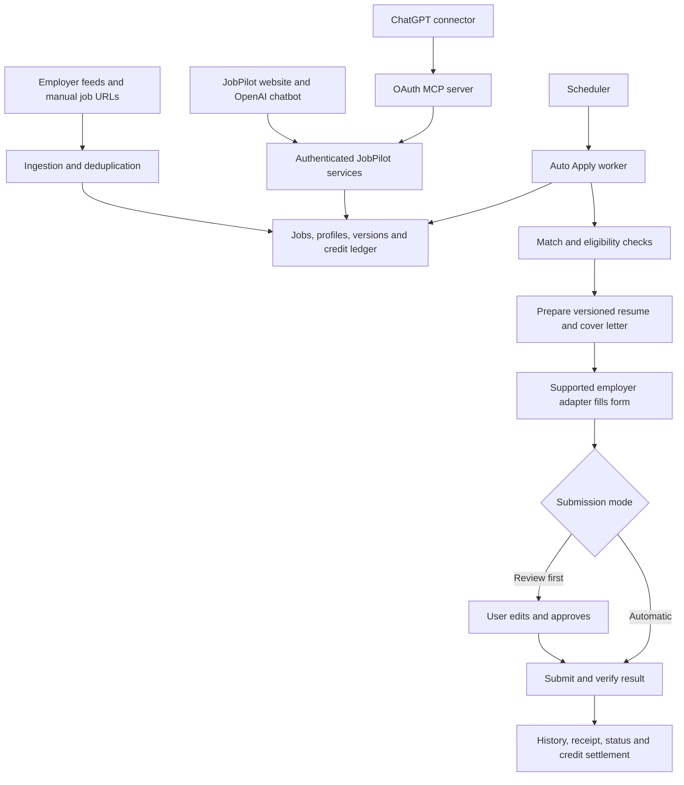

# JobPilot: consolidated Tsenta observations and build requirements

**Master document combining both inspections — October 15, 2026, Europe/Warsaw.**

This is the primary handoff. The first-pass visual/workflow analysis and the second-pass controls, editing, automation, pricing and chatbot findings are organized together below. Later findings supersede earlier unknowns; the two original reports remain provenance, not competing current instructions.

**Current state:** Two explicitly authorized test applications were prepared: ElevenLabs and the user-supplied Hostinger posting. Both remain unsent at review. The Hostinger optimizer added claims the user has not confirmed. Auto Apply remains off and plan-gated. No subscription or top-up was purchased. The GitHub version of JobPilot is the intended implementation target and has not yet been connected in this chat.

**Evidence labels:** Observed = visible UI or authenticated connector read; chatbot statement = explanatory output requiring cross-check; inferred = reasoned explanation; proposed = a JobPilot design choice; unverified = not established. This is an extensive inventory of accessible states, not a claim that every destructive, paid or employer-facing action was executed.

## Contents

1. Inspection scope and entry/sign-in
2. Product, routes, visual design and mobile behavior
3. Chatbot icons, controls and settings inventory
4. Search and filter menus
5. Document/profile editing inventory
6. Workflows and application tests
7. Résumé parsing, tailoring and ATS assumptions
8. Auto Apply, modes, schedule, caps and chatbot cross-check
9. Fresh jobs and source-pipeline design
10. Pricing, credits, payments and owner account
11. JobPilot build blueprint and OpenAI bot in both places
12. Remaining gaps and evidence

## 1. Inspection scope and entry/sign-in

Desktop inspection was primarily at 1440 × 1000; mobile dashboard/application views at 390 × 844, with some default desktop captures. Logged-out entry was seen in the first pass; signed-in entry redirection was rechecked in the second pass. Google, email and messaging sign-in are advertised. Login copy offers 25 free applications without a card and describes matching, résumé/cover-letter preparation and applications; these are interface claims, not an independently tested new-user grant. WhatsApp/iMessage wording is not evidence that all messaging login mechanisms are portable to another product. Terms and Privacy links were visible; their documents were not audited.

This pass follows the accessible entry, dashboard, assistants, filters, manual import, processing and application review, settings, document editors, pricing, and automation configuration. It complements the earlier inbox, pipeline, Networking and Research inspection.

Opening `/login` while signed in redirected to the dashboard. The earlier logged-out login screenshot remains the evidence for Google, email and messaging entry options. A new account, OTP delivery, messaging authentication, and a second full unauthenticated login were not exercised. The user was not signed out.

Menus, panels and edit modes were opened without saving changes. Exceptions: one additional Hostinger application was explicitly authorized and created, and the user explicitly authorized informational chatbot questions. No final employer submission, plan purchase, upgrade, automation activation, credential reveal or support message occurred.

## 2. Product, routes, visual design and mobile behavior

**Observed:** The product combines job discovery, matching, résumé tailoring, application execution, and follow-up management in one authenticated workspace. Desktop navigation exposes Dashboard, Browse jobs, Auto Apply, Tracker, Networking, Profile, Research, Settings, and a remaining-credit indicator.

| Surface | Observed route | Main responsibility |
|---|---|---|
| Sign-in | `/login` | Google, email, messaging entry points; benefit explanation |
| Dashboard | `/dashboard` | Search/filter controls, top matches, application status table |
| Browse jobs | `/dashboard/recommendations` | Detailed cards, match percentages, skills, save/pass/apply controls |
| Mobile applications | `/dashboard/applications` | Review, sent and issues summaries |
| Application detail | `/dashboard/applications/:id` | Processing or review state; filled application form |
| Auto Apply | `/dashboard/auto-apply` | Plan gate, assistant, résumé lanes, cap, match quality, optimization |
| Tracker inbox | `/dashboard/inbox` | Categorized messages and message-reading layout |
| Tracker pipeline | `/dashboard/tracker` | Stage board, flow graphic, imports/exports and application cards |
| Networking | `/dashboard/networking` | Company context, lookup allowance, contact/outreach entry point, news |
| Résumé | `/dashboard/resume` | Profile selector, document preview and formatting controls |
| Cover letter | `/dashboard/resume?doc=cover` | Saved letter preview and rich-text editing verified in second pass |
| Profile data | `/dashboard/my-profile` | Structured education, experience, projects, defaults, skills, certifications |
| Research | `/dashboard/research` | Editorial article index |
| Settings | `/dashboard/settings` | Apply preferences and integration/account categories |

### Visual system

**Observed:** A restrained, airy workspace surrounds dense practical controls. White panels sit inside a softly tinted outer frame with rounded corners and a subtle border/shadow. Navigation stays compact. Muted gray secondary text, fine separators, outlined pills, and small line icons keep chrome visually quiet. Dark forest green signals selected navigation, active filters, credit balance, and major actions. Black or near-black also appears on primary buttons.

Job cards introduce soft pink, lilac, cream/yellow, and mint backgrounds. Each card organizes location/age and a circular match indicator above the title, with company identity and actions below. Color provides visual rhythm; no evidence established that a specific pastel encodes a specific job category.

**Measured CSS declarations:** Dashboard text uses a `Century Gothic`, `Helvetica Neue`, Helvetica, system sans-serif fallback stack. Main dashboard section headings measured 16px/600; inspected job-title headings measured 22px/700. These declarations do not prove which font file rendered. Login headings declare Inter; form controls declare DM Sans with fallbacks. Login hero heading measured 46px/500, welcome heading 27px/500, form action text 14px, primary action height 48px and form width 400px at the inspected desktop viewport. Pill controls use a very large radius; reproduce with `border-radius: 9999px` rather than the browser's huge computed value.

**Approximate visual targets for a new implementation:** 8px outer inset, 24–32px page padding, 12–20px panel/card radii, 1px pale borders, restrained elevation, and a spacing scale of 4/8/12/16/24/32px. Forest green around #173d31 and pale green around #e8f0eb are visual estimates, not sampled source tokens.

The login desktop layout is a near-even split: brand, credibility badge and benefit narrative on the left; centered sign-in form on the right. Mobile initially displayed a stacked entry experience. Dashboard mobile is a distinct composition rather than a shrunken desktop table.

### Responsive behavior

**Observed at 390 × 844:** The desktop header is replaced by bottom navigation for Jobs, Applications, Auto, Network, Tracker, Research, and Profile. The greeting and short swipe instruction appear on the Jobs view. Filters collapse behind a single counted control. Jobs become large stacked/swipe-style cards with company identity, percentage match, skill chips, timing, and details entry. Swiping itself was not tested because a swipe can initiate an application or skip a job.

Applications has its own mobile route and compact category totals. The initial capture includes its loading/summary state; every populated mobile row state was not exhaustively inspected.

**Proposed:** Switch desktop card grid to a mobile deck and expose bottom navigation below a tested breakpoint around 768px, then tune by content fit. Preserve bottom safe-area spacing and provide explicit keyboard/button alternatives to gestures. Exact source breakpoint and all intermediate tablet states remain **Unverified**.

## 3. Chatbot icons, controls and settings inventory

| Surface | Observed controls and behavior | Evidence |
|---|---|---|
| Global AI assistant | Header/sidebar icon opens assistant; close icon; chat-history dropdown; new-chat plus; conversation delete icons; three suggested prompts; composer; empty send disabled | [Panel](second-pass/evidence/02-main-assistant.jpg), [history](second-pass/evidence/03-assistant-history.jpg) |
| Auto Apply assistant | Own conversation menu/new-conversation icon, three setup prompts, composer, streamed answer, tool-reading status, Copy/Refresh/More controls | [Answer](second-pass/evidence/35-auto-chatbot-answer.jpg) |
| Support messenger | Separate Intercom bubble; close/back/options; expandable-window option; attachment, emoji, GIF, microphone and send controls | [Support](second-pass/evidence/04-support-chat.jpg), [options](second-pass/evidence/05-support-options.jpg) |
| Mobile announcements | What's new icon opens an empty-update panel with a full-changelog link | [Announcements](second-pass/evidence/25-mobile-whats-new.jpg) |
| Mobile help | Help/support opens the support messenger after loading | [Initial help state](second-pass/evidence/26-mobile-help.jpg); later DOM confirmed the messenger |
| Profile actions | Profile dropdown, rename pencil, default marker, delete icon, add-profile, replace and download; default-profile deletion disabled | [Profile picker](second-pass/evidence/30-profile-switcher.jpg) |
| Document visibility | Eye icons for header links and sections; drag/reorder affordance; labels switch | [Overflow](second-pass/evidence/21-resume-more.jpg), [sections](second-pass/evidence/22-resume-sections.jpg) |
| Credit badge | Remaining balance links to Plans & billing | [Plan comparison](second-pass/evidence/12-plan-comparison.jpg) |

The support bubble and job-search assistant are separate products within the UI. Suggested prompts that can initiate applications were not clicked. Support upload, recording, emoji/GIF selection and conversation deletion were only inventoried, not executed. The informational Auto Apply chat was the only chat message sent during this pass.

### Additional settings surfaces

The memory page exposes saved facts/preferences with pin, edit and forget icons. Public portfolio exposes a public/private switch, link, copy, open and LinkedIn-share controls. Referrals exposes a referral link/code customization and sharing controls. Email integrations offers Gmail/Outlook connection entry points and email-notification information. Application-password settings show a masked saved-password state with reveal/update/remove actions; none was executed. AI-assistant settings provide connection and copy controls for Claude, ChatGPT, Claude Code and other MCP clients. Account settings provide sign-out and deletion; neither was executed. The deletion copy described a 30-day scheduled removal period. These are observations of controls, not a complete test of each integration or its security implementation.

## 4. Search and filter menus

- Search scope: title, title plus description, or description only. Include terms become removable chips; separate exclusion field.
- Date: 6 hours, 24 hours, 7/14/30 days and all time.
- Location: searchable locations, a US-only restriction, selected tokens, and an optional remote-country extension. The existing US restriction explains why many earlier feed results were US-based; it was not silently interpreted as the user's desired location.
- Companies: inclusion or exclusion, searchable companies.
- Degree: bachelor's, master's, doctorate.
- Maximum experience: no experience, or up to 1/2/3/5/7/10/15 years.
- Role: software, data/ML, product, design, IT, business functions, engineering disciplines and other categories.
- Job type: internship, entry, mid and experienced.
- Employment: full time, part time, contract. Workplace: remote, hybrid, onsite, verified in the first pass.
- Sponsorship control and quick Apply-settings gear are distinct from a job's Apply button. The gear exposes resume modes, resume auto-approval, automatic cover-letter copy and final-review controls.

Each opened filter has a screenshot and DOM text under `evidence/07-filter-*.{jpg,txt}`. No filter selection was changed in this second pass.

## 5. Document/profile editing inventory

| Editing area | Observed scope |
|---|---|
| Résumé templates | 2: Standard and Jake |
| Fonts | 6: Arial, Calibri, Garamond, Georgia, Times New Roman, Computer Modern |
| Layout | Font size decrease/increase, left/justified alignment, fit-to-one-page |
| Sections | Reorder and hide 6 current built-in sections; add custom sections |
| Header | Hide/show 8 header items: city, state, country, email, phone, GitHub, LinkedIn and website; switch link-label display |
| Inline résumé editing | Personal/header values, summary, education, skills, experience, projects, certifications, dates and bullets; add-entry controls; Save/Cancel |
| Measured current edit mode | 91 input/textarea/contenteditable nodes with this user's existing entries; this is a content-dependent control count, not 91 distinct product features |
| Structured profile | Personal identity, professional summary, education, experience, projects, application defaults, skills, certifications and custom sections |
| Cover letter | Saved letter preview/download; editable rich text with 15 toolbar controls: bold, italic, underline, strike, 3 heading levels, 2 list styles, 3 alignments, link, undo and redo |
| Application review | Editable answers alongside locked profile/document values; source-posting link, status and final submit/cancel |
| Automation | Shared cap; resume profile per lane; filter families; include/exclude keywords; standing instructions; review policy; 4 quality levels; 3 optimization modes; preview and history |

See [inline résumé editor](second-pass/evidence/29-resume-direct-edit.jpg), [cover-letter editor](second-pass/evidence/28-cover-edit.jpg), [section controls](second-pass/evidence/22-resume-sections.jpg), and [automation filters](second-pass/evidence/24-auto-lane-filters.jpg). Edits were not saved during this pass. Some icon-only actions lack a useful textual label in the DOM; JobPilot should label its own icon actions clearly.

## 6. Workflows and application tests

### Accessible journeys

| Journey | Action and observed response | Limit |
|---|---|---|
| Entry | Root redirects to login; user signs in and dashboard becomes accessible | Login submission was completed by user |
| Job detail | Selecting a job opens a right-side panel with requirements, compensation where available, sponsorship, original posting and actions | Source posting links not followed for all jobs |
| Workplace filter | Opens Remote/Hybrid/Onsite options | Those selections were not changed |
| Keyword search | Entering frontend creates a removable keyword chip; feed later shows matching roles | Results load asynchronously; transient old results occurred |
| Status filtering | Selecting Submitted sets `?filter=submitted` and populates submitted rows | Counts are a time-specific account snapshot |
| Auto Apply | Opens plan gate, assistant suggestions, lane summary and shared cap | No upgrade, activation or cap change; informational chatbot questions tested in second pass |
| Manual automation settings | Opens profile, filters, standing instructions, review behavior, minimum quality and optimization controls | No automation settings changed |
| Tracker | Inbox opens; Pipeline switches to a board and flow diagram | No message opened, card dragged, CSV imported/exported or application created there |
| Networking | Company context, news and contact-empty state are visible | No lookup or outreach bundle generated |
| Profile | Structured résumé and editor controls load; education edit dialog saves factual corrections | Broad editing and document-generation correctness not fully tested |
| Single application | Apply on chosen ElevenLabs role starts processing, deducts one credit, reaches application review with attached résumé and filled fields | Final submission remains pending |

Application states observed across account/UI include submitted, in flight, needs attention, failed and skipped. The new application went from active form filling to a paused review form. Its connector status is `PENDING_SUBMIT_REVIEW`; the attachment is optimized and ready. The connector reported no missing required answers. Optional motivation was blank, while a project narrative was generated. No employer receipt or successful submission is claimed.

The review form separates locked profile-derived values and editable responses. It includes source posting navigation, current application state, grouped questions, previous/next application controls, cancel and submit actions. The filled narrative contained specific methods not explicit in the original résumé; those should be confirmed or replaced with supported facts before sending.

### Hostinger manual-link test and later status

User supplied: https://jobs.ashbyhq.com/hostinger/57b7805f-412c-44fa-b8ac-6dc045a4e01d.

Fetched title: Full-Stack Developer | Node.js | AI Builder | Remote. Location: Poland. The form detected Ashby, populated approximately 5,084 characters of description and enabled optimized application. An existing Hostinger application was a different posting. The user then explicitly authorized this additional application.

Observed flow: import → fetch description → optimization → ready attachment → employer form filling → review before submission. One additional credit was reserved; available balance became 571. The connector reports no missing required fields. The application is still **unsent**.

#### Tailored résumé additions

The actual [Hostinger attachment](second-pass/tailored-hostinger-resume.pdf) was retrieved and rendered. It contains the corrected Computer Science major, no master's end date, and GPA 7.0. It adds:

- SQL queries and ORMs to AHAAN work;
- SQL queries to Celebal work;
- testing practices to a mentoring responsibility;
- skill entries for SQL/ORM work and Jest;
- CI/CD pipeline wording and a performance-optimization skill label.

Some concepts overlap the original (for example, performance optimization and Azure DevOps), but the original does not establish every new employer-specific activity or tool claim. The user clarified that only some added claims may be true. **No blanket confirmation of these additions remains valid.** The application must remain pending until the actual attachment and any inaccurate claims can be corrected or explicitly confirmed.

The form also preselects agreement to an independent-contractor arrangement and optional future-contact consent, and fills compensation as Negotiable. Those are visible generated answers, not proof of the user's preferences. The inspection does not accept them on the user's behalf.

Review link: https://dashboard.tsenta.com/dashboard/applications/46c2266d-7060-4b49-813d-15a2b53a8d19. Screenshot: [review state](second-pass/evidence/18-hostinger-review.jpg).

## 7. Résumé parsing, tailoring and ATS assumptions

### Original, base profile and ElevenLabs document

Three different artifacts matter:

1. The original uploaded PDF is a portrait/photo-led, purple-accented, two-column résumé, with professional material on the left and technical skills/tools on the right.
2. The saved Tsenta profile is a structured, plain résumé representation with selectable templates, font, size, alignment and section order.
3. The ElevenLabs attachment is a separate one-page, single-column, job-specific PDF. Its structured content was retrieved through the connector and its PDF downloaded for comparison. It was generated before the later profile corrections.

**Verified additions in the application résumé:**

| Area | Tailoring relative to original/base content | Corresponding job emphasis |
|---|---|---|
| Summary | Leads with frontend-leaning full-stack experience and complex interactive UI work | Frontend-heavy interactive product work |
| Summary | Adds product-minded ownership from proposal to launch and connects side projects | Product responsibility and feature ownership |
| AHAAN responsibility | Adds complex UI and product-facing framing | Complex interfaces and product-facing experience |
| API responsibility | Adds explicit work across the full stack | Frontend with sufficient backend ability |
| Carbon Warrior | Adds ownership through launch | End-to-end feature delivery |
| Local AI assistant | Adds greenfield/from-scratch framing | New feature development |

The original already contained the ~30% development-time improvement and ~40% chart/data performance improvement. Those numbers were **not newly invented by this tailoring run**. Much of the remaining experience and project content is preserved.

**Qualification:** Wording can be relevant while still needing factual confirmation. The original does not explicitly establish proposal-through-launch ownership. A builder should distinguish source-supported rephrasing from newly inferred claims.

**Education comparison and corrections:** The original PDF visually shows 7.9/10; the user subsequently clarified that **7.0/10 is correct**, which takes precedence. The original describes the master's as ongoing and the bachelor's major as Computer Science. The saved profile had a June 2026 master's end date and Computer Engineering. The end date was cleared and the major corrected to Computer Science through the UI; GPA remained 7.0. Saved UI state confirmed the correction. However, the application-specific attachment still contains the earlier June 2026 and Computer Engineering values. A later profile edit did **not** retroactively update this attachment.

The available regeneration tool only supports the earlier résumé-review checkpoint. This application has passed that checkpoint and is paused at form review. Its existing attachment cannot be assumed refreshable through the inspected controls. The application remains unsent while this mismatch is unresolved.

### Parser and ranking corrections

The original PDF had no extractable text in the local PDF reader and required visual rendering. An upload pipeline needs text extraction plus OCR/vision fallback, followed by structured data validation and user review. Preserve original files separately from editable profile data and job-specific snapshots.

The simplified one-column PDF is a reasonable parsing target. Greenhouse documents potential parsing problems with graphics, images, complex tables and columns, but also has optional AI-powered matching; ATS products cannot all be reduced to plain-text databases. Sources: [parsing limitations](https://support.greenhouse.io/hc/en-us/articles/200989175-Unsuccessful-resume-parse), [Talent Matching documentation](https://support.greenhouse.io/hc/en-us/articles/41131616864283-Talent-Matching-Data-Processing-FAQ).

Semantic retrieval can use embeddings, but multiplying cosine similarity by 100 does not establish a probability of passing an employer's ATS. Combine retrieval with explicit location, authorization, experience and required-skill constraints, and show an explainable relevance score. [OpenAI embedding documentation](https://developers.openai.com/api/docs/guides/embeddings) supports semantic similarity usage; the calibration and score interpretation are JobPilot design work.

Rewriting must preserve verified skills, dates and metrics. A prompt saying to add metrics wherever appropriate is insufficient: numbers must have source evidence or user confirmation. The observed Honest-mode changes demonstrate why generated claims need a reviewable diff.

## 8. Auto Apply, modes, schedule, caps and chatbot cross-check

### Visible settings and separate approvals

**Observed:** Apply settings offers **Off**, **Honest**, and **Aggressive** résumé optimization modes. Honest is selected. The selected mode's explanation says it reorders/highlights relevant experience. Off and Aggressive were not activated, so their actual rewrite results were not tested.

Auto-approve is enabled. The UI explicitly explains that tailored résumés bypass preview under that setting. Review before submit is also enabled. These control different checkpoints: approving the generated document versus approving the completed employer form. Cover letters are described as generated automatically when the job requests one, using the profile and saved cover letter; none was used for this test application.

Auto Apply has separate lane controls: a shared daily cap, résumé profile, job filters, standing exclusion instructions, review policy, quality thresholds Excellent/Strong/Good/Stretch, and optimization. Its displayed copy says review pauses only on supported job sites and other sites can submit normally. This exception must be explicit in any comparable product. Actual scheduler operation was not tested.

### Detailed operational observations

#### Account and defaults

The connector explicitly reports `configExists: false`: the displayed setup has never been saved. Its default is off, 10 applications/day, Honest optimization, one default lane, a 75 threshold and a 24-hour posting window. The account is on Starter; Power is required. No previous automatic runs are recorded. The résumé-matching representation is stale relative to the recently edited profile; no refresh was performed during inspection.

#### Worker behavior exposed by tools and UI

- Four scheduled checks per day, at 05:00, 11:00, 17:00 and 23:00 America/New_York time. On the inspection date these correspond to 11:00, 17:00, 23:00 and 05:00 in Warsaw. Timezone-aware scheduling is necessary across daylight-saving changes.
- A separate new-match trigger is exposed by the connector, but it is false for this blocked account. Do not claim event-triggered runs were tested.
- The operational job-age window is 24 hours; the visible 7-day preview estimates available supply and is not the next-run queue.
- Up to five lanes in the UI. Each can use its own resume, filters, quality bar, instructions, optimization and review policy.
- All lanes share one daily cap and the user's available credits. Adding a lane does not multiply the daily allowance.
- Lane instructions are described in the UI as an exclusion check, not a way to add jobs outside the candidate search.
- Manual-application review settings and lane review settings are separate. The account setting does not automatically govern Auto Apply.
- Review is limited to supported application systems. The UI warns that other systems can submit normally even with a lane review toggle enabled. This limitation was not exercised against an unsupported employer.
- Auto Apply is a worker flow, not a browser tab that needs to stay open. Actual unattended execution was not enabled or tested because the plan gate remains in place.

#### Read-only preview

A connector dry run for a 24-hour window considered 60 rows, found 49 at/above the default threshold and reported up to 10 would apply under its current caps. The result explicitly says the sample was saturated and its supply estimate was sampled. Another estimate in the same output was 2.3 matches per weekday. These are different measures; neither is a guarantee that ten applications will be sent every day. No application or run log was created by this preview.

The loaded browser preview later showed 246 matches over seven days. During initial loading it briefly displayed a no-matches message before populated results arrived. JobPilot should distinguish loading from a genuine empty result.

#### Chatbot cross-check

The Auto Apply chatbot read account state and repeated the plan blockers, unsaved defaults, four daily checks, lane model, caps and separate review controls. It explicitly stated that it cannot identify the upstream job-data suppliers. Its initial description of lane cover-letter mode conflicts with the UI's automatic-cover-letter wording; see the saved [chat explanation](second-pass/auto-apply-chatbot-explanation.txt) and any clarification below. This discrepancy is not resolved by assuming that either text proves actual runtime behavior.

### Follow-up chatbot clarification

The follow-up chatbot confirmed that lane review pauses only on supported application systems and other systems may submit normally. On cover letters it asserted that lane mode `off` would omit letters, but then said it cannot verify whether the UI's Automatic wording represents a different manual-apply subsystem or a legacy field. The UI wording in question was actually observed inside Auto Apply's Manual settings dialog. The conflict remains unresolved; neither chatbot confidence nor the raw field alone proves the current worker's document-generation behavior. JobPilot's user requirement is unambiguous: generate an appropriate cover letter when the destination requires one and expose one consistent policy across UI, API and worker.

## 9. Fresh jobs and source-pipeline design

**Observed:** Jobs carry age indicators and original employer/application URLs. The manual-link form accepts a URL, detects the application system, fetches a job description, and uses it to tailor the résumé. The Job Boards settings page exposes an Indeed connection, described as adding the board's matches to the feed. The manual-import page advertises a Chrome extension for detecting supported postings on sites such as LinkedIn, Jobright and Hiring Cafe.

These observations do not identify Tsenta's bulk-feed supplier, ingestion interval or complete internal crawler design. The claim that Tsenta never uses Indeed is contradicted by its integration UI; the presence of an integration does not prove that every feed job comes from it.

**Proposed for JobPilot:** Maintain an employer/ATS board registry and poll permitted public feeds through queued adapters. Normalize, deduplicate, record timestamps, compute content hashes, update embeddings only when meaningful content changes, recheck availability, and then evaluate automation lanes. Track `published_at`, `first_seen_at`, `last_seen_at` and `updated_at` separately. An update is not necessarily a new publication; polling is near-real-time with measurable latency, not instant delivery.

Public board APIs are a workable source for known employers: [Ashby's public posting API](https://developers.ashbyhq.com/docs/public-job-posting-api) exposes currently published jobs, descriptions, apply links and a last-published timestamp. [Greenhouse's Job Board API](https://docs.greenhouse.io/job-board.html) exposes public GET data, but its application POST endpoint requires an employer API key. [Lever's official postings documentation](https://github.com/lever/postings-api) also documents public postings. Public listing access must not be confused with unrestricted application-submission access.

## 10. Pricing, credits, payments and owner account

Prices were read from the live plan comparison on the inspection date; no purchase occurred.

| Plan | Monthly package | Quarterly package | Annual package | Monthly application allowance | Auto Apply |
|---|---:|---:|---:|---:|---|
| Starter | $19 | $49 | $159 | 600 | No |
| Pro | $39 | $79 | $299 | 1,500 | No |
| Power | $99 | $239 | $799 | 4,500 | Yes |

Quarterly and annual figures are whole-package prices, not monthly equivalents. Evidence: [monthly](second-pass/evidence/12-plan-comparison.jpg), [quarterly](second-pass/evidence/32-pricing-quarterly.jpg), [annual](second-pass/evidence/33-pricing-annual.jpg).

The top-up UI offers $0.10 per application, minimum $5, and says wallet credits do not expire. Its example $20 amount corresponds to approximately 200 applications. It says unsuccessful applications are refunded. Actual observed starts reduced available balance while still pending; a JobPilot ledger should distinguish available, reserved, charged and refunded credits. Evidence: [wallet top-up](second-pass/evidence/34-credit-topup.jpg).

### Confirmed JobPilot billing choices

Charge customers in USD. Each reference package gains a markup equal to 20 PLN converted at a stored, dated PLN-per-USD rate: `final USD = round(base USD + 20 / rate, 2)`. Do not publish invented conversion figures. The owner/admin bypasses customer checkout, tier gates and credit deductions through server-side authorization. A coin-like badge represents available application credits, not cryptocurrency. Payments, webhooks, ledger accounting, login linking and admin rules are specified in the blueprint below.

## 11. JobPilot build blueprint and OpenAI bot in both places

User requirements captured October 15, 2026. Target: the GitHub version of JobPilot, which the user will connect. This is a product/architecture handoff, not a claim that these features are implemented. The local JobPilot README was inspected only to identify the existing assisted application tool; no repository code was changed.

### Confirmed scope

Build the experience around fresh-job discovery, an editable structured profile, job-specific résumé/cover-letter preparation, application execution, tracking, and two submission choices: automatic or review-first. Include a website chatbot powered by OpenAI, a ChatGPT connection, comparable subscription/credit packages, and owner access without customer charges. Preserve the detailed visual/editor inventory in the [audit](second-pass/report.md).

### Shared architecture

Use one application service and one entitlement/authorization layer for the website, chatbot, ChatGPT tools and scheduled workers. An assistant is an interface to the same operations, not a second database or an independent permission system.

Keep the existing Python backend where practical after inspecting GitHub. A task queue, relational storage, document storage and application adapters can be separate services without forcing a frontend/framework rewrite. PostgreSQL with pgvector is a candidate for semantic retrieval, not a requirement established by the reference site. Queue technology should follow the repository's runtime: for example, a Python worker rather than introducing a second Node stack just for BullMQ.

### Fresh listings and matching

Maintain a registry of company, source type and board identifier. Poll permitted employer/partner feeds; separately accept user-supplied application URLs. Preserve source IDs, canonical URLs and original descriptions. Normalize geography, employment type, remote-country restrictions, dates and requirements. Hash meaningful content, deduplicate, track closures, and recheck the posting before submitting.

Maintain published, first-seen, updated and last-seen timestamps separately. A modified or republished role must not masquerade as newly discovered without an explanation. Make ingestion latency observable. Polling interval is configurable; select it from source limits and deployment cost rather than promising instant updates.

Use semantic retrieval to find candidates, then apply explicit requirements for geography, authorization, seniority, skills and user preferences. Explain the score and missing requirements. Do not market a raw cosine score as an employer ATS-pass probability. Refresh the matching representation after verified profile changes.

Public feeds support known-company coverage: [Ashby](https://developers.ashbyhq.com/docs/public-job-posting-api), [Greenhouse](https://docs.greenhouse.io/job-board.html), [Lever](https://github.com/lever/postings-api). Job discovery and employer submission need separate integrations; a public listing endpoint is not universal permission or credentials for submitting applications.

### Résumé and cover-letter engine

Retain original PDF/DOCX → text extraction with OCR/vision fallback → schema-validated profile → user correction → versioned baseline résumé. The original uploaded PDF in this inspection was image-based, so plain text extraction alone is insufficient.

For each job, extract requirements and rewrite/reorder source-supported content into a separate version. Preserve identifiers linking each change to its source facts. Show a before/after diff, additions, removed content and the exact employer attachment. Never invent numerical achievements. Proposed new claims require user confirmation and must not silently enter automatic applications. Keep eligibility answers separate from persuasive copy.

Render a selectable-text PDF with predictable reading order and standard section headings. Offer the observed template/font/layout controls, section order/visibility, custom sections, inline editing, replacement and download. Verify text extraction and rendered output, not only that a file was produced.

Generate a job-specific cover letter when the employer requests or accepts one, using verified profile facts, job requirements and the user's saved letter. Keep it editable with the rich-text controls in the audit. The user's requirement is clear even though Tsenta's lane fields and UI wording disagree. JobPilot should expose one documented rule consistently in its UI, APIs and worker.

### Auto Apply and review modes

Support multiple lanes, each with its own résumé profile, job filters, keywords, match threshold, standing exclusions, optimization and submission choice. Enforce one shared daily cap across lanes, separate from available account credits. Show last run, next run, matches considered, exclusion reasons, pending reviews and outcomes.

Worker pipeline: discover/refresh → deduplicate → hard-constraint checks → relevance rank → user exclusions → reserve credit/cap slot → prepare immutable documents → validate claims → fill supported form → review or submit → verify receipt/status → settle or refund. Persist progress and use idempotency keys so retries do not double-submit or double-charge.

**Automatic mode:** submit only through adapters that support the required fields and verified answers. Unknown required answers, unsupported widgets, CAPTCHA or unverified factual additions become an actionable pause. Automatic mode is prior user authorization for the configured job-selection rules, not permission for unrelated account changes.

**Review-first mode:** show exact documents and filled answers, then wait for explicit submission. Unlike Tsenta's observed fallback, JobPilot should not silently auto-submit on a site that cannot pause. Mark it unsupported for review-first and hand it back to the user. This is a proposed improvement requested by the meaning of review-first, not a claim about Tsenta.

Track résumé approval separately from form submission. Editing source facts must mark pending derived artifacts stale. A new profile revision must not silently mutate a document already sent to an employer.

### OpenAI bot in the website and ChatGPT

For the website, use a server-side OpenAI Responses API integration with a bounded tool set. Function calls request application operations; the backend validates and executes them. [Official function-calling documentation](https://developers.openai.com/api/docs/guides/function-calling).

For ChatGPT, expose those same services through an authenticated MCP server, with user-scoped tool authorization. OAuth 2.1 links the user's JobPilot account. Keep tokens and provider secrets on the server, and validate identity on every call. [MCP server documentation](https://developers.openai.com/plugins/build/mcp-server), [authentication documentation](https://developers.openai.com/plugins/build/auth).

Suggested tools: read profile; search jobs; fetch a supplied posting; explain a match; draft a résumé/letter; inspect a diff; preview automation; propose/save lane settings; read credits; inspect application; approve submission; read history. Separate read/preview tools from writes. Both clients use the same review flags, limits, confirmation records and version checks.

Chat UI should include a clear icon, contextual starter prompts, history/new conversation, visible tool progress, editable memory, and understandable error/retry states. Keep support chat distinct from the job-search agent. Conversations themselves must not rewrite confirmed profile facts without a reviewable change.

### Payments, credit badge and admin

The user chose USD billing with a markup equal to 20 PLN **per package**. Let `R` be the stored PLN-per-USD exchange rate when a price version is published:

`markup_usd = 20 / R`

`checkout_price_usd = round(base_package_usd + markup_usd, 2)`

Store rate source, rate date, base price, markup and final price. Publish a stable provider price rather than fetching an unpredictable live FX rate during checkout. No exact new USD prices are asserted before a rate is selected.

Reference catalog from the inspected UI:

| Tier | Monthly base | Quarterly base | Annual base | Monthly credits | Auto Apply |
|---|---:|---:|---:|---:|---|
| Starter | $19 | $49 | $159 | 600 | No |
| Pro | $39 | $79 | $299 | 1,500 | No |
| Power | $99 | $239 | $799 | 4,500 | Yes |

The markup is interpreted as once per purchased billing package: once for a monthly, quarterly or annual purchase, not once per month within a prepaid annual package. This assumption should be confirmed when publishing prices. Monthly credits should refresh according to the entitlement policy even when payment is quarterly/annual.

Tsenta's wallet reference is $0.10/application with a $5 minimum, no expiry and refund wording. For a comparable JobPilot top-up, grant credits based on the base package value; charge the base package plus the markup. Do not mistakenly award extra credits for the markup or call a paid balance cryptocurrency. Fixed starter packages can be offered alongside a validated custom amount.

Use hosted checkout and verified, idempotent payment webhooks. Credit grants occur after a confirmed payment event, never because the browser opened a success URL. Track free, subscription and purchased buckets, plus reservations, charges, refunds, expiry and cycle resets. The visible badge shows available application credits; application history explains deductions and refunds. Budget/cap reservations must be atomic across manual and scheduled jobs.

Provision the owner's verified identity as a server-side admin role. Admin skips customer checkout, tier restrictions and credit debits; show an Admin badge or unlimited entitlement rather than a misleading paid balance. Never grant admin because the frontend sends a flag or the email merely resembles the owner's address. Retain operational limits/audit history. Admin customer billing is waived; hosting and model-provider usage still belong to the site operator.

### Sign-in and identity

Requested providers: Google, email, phone, plus supported messaging alternatives. Proposed initial flows: Google OAuth, email one-time link/code, and SMS phone verification. Add WhatsApp/messaging only through a real supported provider. An iMessage label on a reference UI does not establish a portable public iMessage-auth API.

Link verified providers to one account so signing in by phone after Google does not create a second paid balance or different profile. Account recovery, logout, session expiry, provider linking and admin bootstrap must be defined against GitHub and the deployment's identity provider. Do not alter the user's existing cloud accounts during this planning pass.

### Verification and GitHub handoff

Acceptance: both clients use the same profile; old document versions remain auditable; new claims require confirmation; a paid event grants credits once; duplicate clicks and worker retries do not double-charge; failed/refunded applications have clear ledger entries; admin bypass cannot be activated by a normal user; source refresh and review queues behave across restarts; review-first never silently submits; automatic cover-letter rules are consistent; job age and match explanations are accurate; responsive/editor controls and icon labels are usable.

When GitHub is connected, inspect its instructions, current authentication, storage, billing and job adapters before choosing concrete migrations or libraries. Preserve existing behavior while implementing in reviewable stages. No deployment, payment setup, plugin publication or employer submission is implied by this blueprint.

### Original component, data and validation handoff

#### Presentation and components

Build a shared desktop shell and a mobile shell, with route-specific content. Reusable components: navigation/credit badge, search-token input, filter chips/popovers, match ring, company identity, pastel job card, mobile job deck, job detail drawer, application table/status pills/pagination, dynamic review form, profile/document tabs, résumé preview/toolbar, settings mode selector, plan gate, lane panel, assistant prompt cards/composer, inbox list/reader, pipeline columns and flow graphic, company research panel, and article cards.

Maintain separate visual tokens for app typography and document typography. The downloadable résumé should render from structured content and an explicit document style model rather than screenshotting the app editor. Use original/licensed logos and imagery; reference-site assets are not assumed available for reuse.

#### Data and services

**Proposed entities:** User; ResumeProfile; Education/Experience/Project/SkillCategory; immutable ResumeVersion; Job and Company; MatchScore; Application; ApplicationEvent; FormField/Answer; GeneratedDocument; ApplyPreferences; AutoApplyLane; CreditLedger; Message/Thread; PipelineStage; Contact/OutreachDraft; ResearchArticle.

ResumeProfile is editable source data. ResumeVersion stores the exact source revision, job revision, optimization mode, generated content, PDF artifact, and change summary. Application references the exact ResumeVersion used. This prevents a profile preview from being mistaken for the employer attachment.

Client state should own open drawers, draft search controls, selected tabs and pending edits. Server state should own job search results, account credit ledger, profile revisions, application progress and generated artifacts. Background workers should handle parsing, matching, optimization, PDF generation, application execution and message ingestion. These are **proposed responsibilities**, not assertions about Tsenta's internal infrastructure.

#### Core workflow and state model

Proposed flow: upload → extract structured profile → user verifies extracted facts → browse/filter → inspect job → start single application → snapshot source/job/mode → tailor résumé → validate factual claims → render PDF → optional résumé approval → fill employer form → optional form review → submit → record receipt/failure → track follow-up.

Model résumé approval and form approval independently. Preserve each generated version and show an original-versus-tailored diff. A source edit should mark pending attachments stale and offer explicit regeneration before submission. Avoid silently changing an already-sent artifact.

Proposed application state families: preparing, optimizing résumé, awaiting résumé review, preparing cover letter, ready, running/filling form, awaiting form review, submitting, submitted, failed and skipped. Separate application status from pipeline stage: interviewing/rejected/offer are downstream outcomes, not optimizer states.

For automated lanes, evaluate all lanes against one shared cap, deduplicate applications, enforce plan entitlements, and make review support explicit per employer adapter. Use idempotency keys for submissions and credit debits; retries must not create duplicate applications. These are implementation requirements derived from the observed workflow, not verified source guarantees.

#### Build sequence

1. Establish tokens, responsive shells and route skeletons with fixture data.
2. Build verified profile import/editing, revision history, original-document storage and résumé rendering.
3. Add job ingestion, search/filter controls, cards, match explanation and detail drawer.
4. Implement job-specific rewriting, evidence-backed claim checks, diff preview and versioned documents.
5. Add the application worker, dynamic form review, source-consistent attachments and status updates.
6. Add application table, inbox and pipeline, then plan/credits and automated lanes.
7. Add company/contact research and assistant features after the core application path is reliable.

#### Acceptance checks

- Desktop and mobile reproduce their observed compositions at the inspected sizes; mobile has safe-area clearance and explicit alternatives to swipe actions.
- A selected filter is visible, removable and reflected in search results after loading. Old results are visually distinguished during refresh.
- Job detail opens/closes without losing feed position; focus returns to its trigger.
- Every application exposes the exact attached document and its source revision.
- Honest-mode rewriting preserves facts; inferred additions require confirmation. Numeric claims remain traceable to user source data.
- Résumé auto-approval and final form review behave independently.
- Editing education marks an already-generated pending résumé stale; regeneration or replacement is required before submission.
- A single authorized Apply produces one application and one credit debit. Recoverable errors and duplicate clicks do not double-submit.
- Review fields distinguish editable answers from locked source fields; missing required answers block submission with clear guidance.
- Success requires an explicit worker/employer result, not just a credit decrement or attachment-ready state.
- Keyboard navigation, focus visibility, drawer/modal behavior, text contrast and loading/error/empty states are tested. No accessibility conformance claim is made for the reference site.

## 12. Remaining gaps and evidence

This is a detailed inventory of accessible controls, not a claim that every possible state or every action has been executed. Paid unattended execution, checkout completion, every employer adapter, new-account onboarding, message delivery, all external login providers, deletion, account linking and every tablet/mobile subpage remain untested. Data-provider identity is still unknown. The application tests establish preparation and review, not employer submission success.

Screenshots and DOM captures are listed in `inspection-manifest.json`. They include private account evidence and should remain local rather than being copied into a public GitHub repository.

### First-pass evidence

All browser images below are local inspection evidence, not product assets.

- [Desktop login](evidence/login-desktop.jpg)
- [Desktop dashboard](evidence/dashboard-desktop.jpg)
- [Job detail drawer](evidence/job-detail.jpg)
- [Browse jobs with onboarding overlay](evidence/browse-jobs.jpg)
- [Workplace options](evidence/workplace-filter.jpg)
- [Auto Apply page](evidence/auto-apply.jpg)
- [Auto Apply manual settings](evidence/auto-settings.jpg)
- [Inbox controls](evidence/inbox-controls.jpg)
- [Pipeline](evidence/pipeline.jpg)
- [Networking](evidence/networking.jpg)
- [Research index](evidence/research.jpg)
- [Profile controls](evidence/profile-controls.jpg)
- [Dashboard mobile](evidence/dashboard-mobile.jpg)
- [Mobile applications summary](evidence/applications-mobile.jpg)
- [Existing review state](evidence/review-state.jpg)
- [Selected ElevenLabs job](evidence/selected-job.jpg)
- [Live application review](evidence/live-application.jpg)
- [Apply settings and modes](evidence/apply-settings.jpg)
- [Saved education correction](evidence/education-corrected.jpg)
- [Original résumé rendering](evidence/original-resume.png)
- [Job-specific attachment](tailored-elevenlabs-resume.pdf)

### Second-pass evidence

[Manifest](second-pass/inspection-manifest.json) lists the additional captured states. [Auto Apply chatbot transcript](second-pass/auto-apply-chatbot-explanation.txt) includes the informational explanation and the follow-up clarification. [Hostinger résumé](second-pass/tailored-hostinger-resume.pdf) is the actual generated attachment, not a reconstruction.

### Source reports and preservation

[First-pass source](report.md) and [second-pass source](second-pass/report.md) are retained. The consolidated text includes the first-pass purpose/routes, measured visual tokens, responsive observations, workflow table, actual résumé comparison, component/data architecture, build sequence and acceptance checks; it adds the second-pass detailed controls, editing counts, Auto Apply diagnosis and dry run, chatbot caveats, provider research, manual Hostinger test, pricing, payment/login/admin requirements and shared OpenAI/MCP architecture. Historical account counts remain snapshots, not live promises.
